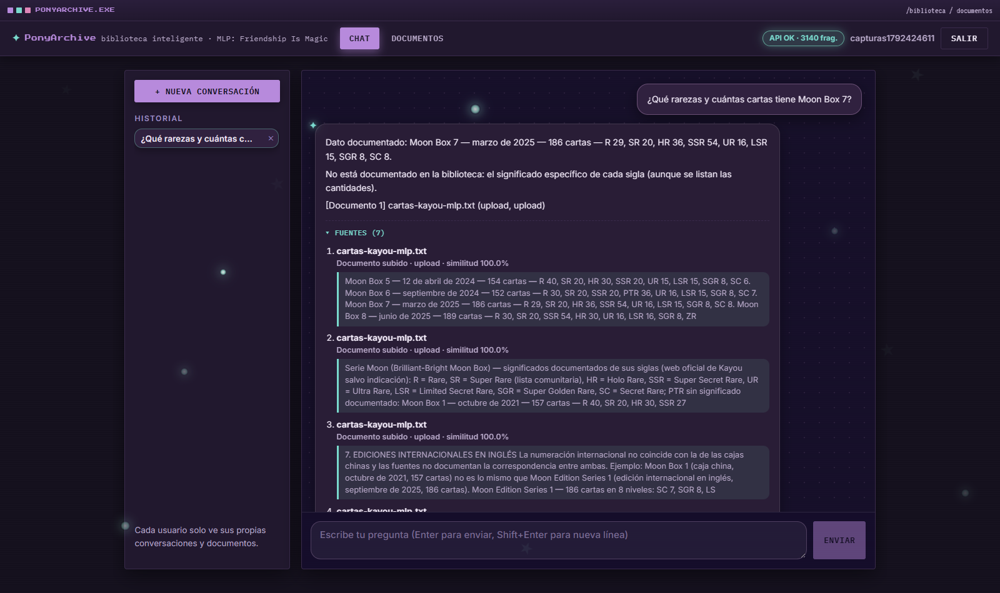

<p align="center">
  
</p>

<p align="center">
  <a href="https://pony-archive.vercel.app" title="Probar PonyArchive en la nube">
    
  </a>
</p>

<p align="center">
  
  
  
  
  
  
  
  
</p>

**PonyArchive** es una biblioteca inteligente de *My Little Pony: Friendship Is Magic* (G4) con un
agente RAG (LangChain + LangGraph), modelo local en Ollama y una base vectorial propia.

El agente responde preguntas sobre los **243 episodios, 555 personajes y 192 canciones** de la serie a
partir de su propia base de conocimiento indexada (1.001 documentos → ~3.100 fragmentos), muestra las
fuentes recuperadas con su similitud y **se niega a responder** cuando la evidencia no alcanza.
Incluye autenticación con JWT, historial por usuario, carga de documentos y despliegue en la nube
(0 USD).

<p align="center">
  
</p>

<p align="center">
  
</p>

<p align="center"><em>Respuesta fundamentada: el agente cita las fuentes recuperadas con su título, tipo y similitud.</em></p>

<p align="center">
  
</p>

<p align="center">
  
</p>

<p align="center"><em>Rechazo honesto: sin evidencia en la base de conocimiento, responde con la frase literal en lugar de inventar.</em></p>

<p align="center">
  
</p>

## Requisitos

| Componente | Versión | Notas |
|---|---|---|
| Python | 3.11+ | backend y agentes |
| Node.js | 20+ | frontend (Vite + React + TS) |
| Ollama | latest | modelo local `qwen3.5:4b` (también compatible con `llama3.2`) |

## Arranque rápido (local)

```bash
# 1. Backend
cd backend
python -m venv .venv && source .venv/bin/activate   # Windows: .venv\Scripts\Activate.ps1
pip install -r requirements.txt
cp .env.example .env            # revisar EMBEDDINGS_PROVIDER=local, LLM_PROVIDER=ollama, VECTOR_PROVIDER=chroma
ollama serve &
ollama pull qwen3.5:4b
python -m uvicorn app.main:app --reload --port 8000

# 2. Frontend
cd frontend
npm install
npm run dev                     # http://localhost:5173
```

Al arrancar, el backend importa automáticamente episodios, personajes y canciones desde
[Pony API](https://github.com/PonyAPI/mlp-fim-api) y los enriquece con la [wiki de Fandom](https://mlp.fandom.com)
(CC BY-SA): sinopsis de los episodios y descripción de los personajes. La primera arrancada en una BD
vacía tarda ~8–10 min (243 episodios + 555 personajes + 192 canciones); posteriores lo omiten si ya
están indexados (la ingesta es idempotente).

<p align="center">
  
</p>

## Características

| Característica | Estado | Detalle |
|---|---|---|
| Agente RAG con LangGraph | ✅ | Grafo con clasificación de intención, recuperación filtrada y respuesta fundamentada |
| Base vectorial | ✅ | Chroma local / Qdrant Cloud; embeddings e5-small (384d) u OpenAI |
| Respuestas con fuentes | ✅ | Cada respuesta lista los fragmentos con título, tipo y similitud |
| Anti-alucinación | ✅ | 7 estrategias: umbral de similitud, validación de entidades, rechazo literal, conteos por SQL… |
| Modelo local | ✅ | `qwen3.5:4b` vía Ollama |
| Autenticación JWT | ✅ | Registro, login, logout y refresh; historial por usuario |
| Carga de documentos | ✅ | Sube .txt/.md y pregúntales al agente |
| Despliegue en la nube | ✅ | Frontend en Vercel y backend en Render (0 USD), pila dual por variable de entorno |

<p align="center">
  
</p>

<p align="center"><em>Biblioteca y cargas propias: pestañas Todos/Biblioteca/Míos, filtros y borrado con confirmación.</em></p>

<p align="center">
  
</p>

## Credenciales de prueba

Crea una cuenta desde la propia UI de registro. Hay un usuario de demostración en el seed:

| Campo | Valor |
|---|---|
| Email | `demo@ejemplo.com` |
| Contraseña | `pony123` |

## Estructura del proyecto

```text
PonyArchive/
├── backend/
│   ├── app/
│   │   ├── routers/         # auth, chat, documents, library, importer, health
│   │   ├── services/        # embeddings, vectorstore, llm, pony_api, fandom, themes…
│   │   ├── agents/          # grafo LangGraph (graph.py, state.py)
│   │   ├── config.py        # ajustes y flags dual local/nube
│   │   ├── database.py      # SQLAlchemy (usuarios, conversaciones, documentos)
│   │   ├── models.py        # modelos ORM
│   │   ├── security.py      # JWT y hashing de contraseñas
│   │   ├── seed.py          # semilla de la biblioteca base
│   │   └── main.py          # composición de la API (FastAPI)
│   ├── scripts/             # smoke_test.py, e2e_compose.py, import_pony.py
│   └── requirements.txt
├── frontend/
│   ├── src/
│   │   ├── pages/           # Chat, Documentos, Login
│   │   ├── components/      # Answer (fuentes desplegables)
│   │   ├── api.ts           # cliente HTTP tipado
│   │   └── index.css        # tema oscuro (paleta Starlight Glimmer)
│   └── vite.config.ts
├── docs/
│   ├── documento-tecnico.md  # documento técnico (fuente)
│   ├── documento-tecnico.pdf # documento técnico (PDF)
│   ├── presentacion.pdf      # láminas de la demo
│   ├── cartas-kayou-mlp.txt  # documento de ejemplo para la demo (carga en vivo)
│   ├── capturas/             # capturas de pantalla
│   └── despliegue-nube.md    # checklist del despliegue en nube
├── render.yaml               # blueprint del backend en Render
└── docker-compose.yml
```

<p align="center">
  
</p>

## Endpoints

| Ruta | Contenido |
|---|---|
| `/health` | Estado del servicio, modelo y fragmentos indexados (sin auth) |
| `/docs` | Documentación OpenAPI/Swagger (sin auth) |
| `/api/auth/register` | Registro y creación de cuenta (sin token previo) |
| `/api/auth/login` | Login y emisión de token JWT |
| `/api/chat` | Consulta al agente RAG (con Bearer token) |
| `/api/chat/conversations` | Historial de conversaciones por usuario |
| `/api/documents` | Listado, subida y borrado de documentos (con token) |
| `/api/library/search` | Búsqueda en la biblioteca compartida |
| `/api/import/*` | Importación de Pony API: episodios, personajes y canciones (con token) |

## Despliegue en la nube (0 USD)

**Aplicación desplegada:** [**https://pony-archive.vercel.app**](https://pony-archive.vercel.app)
· API: [**https://ponyarchive-api.onrender.com**](https://ponyarchive-api.onrender.com)

La arquitectura en nube usa **frontend en Vercel + backend en Render + Qdrant Cloud + OpenAI**
(embeddings y chat). El frontend solo habla con el backend por `/api`; el modelo y la base vectorial
quedan tras la API. Los tres providers se cambian por variable de entorno (`EMBEDDINGS_PROVIDER`,
`LLM_PROVIDER`, `VECTOR_PROVIDER`); los valores por defecto son la pila local.

El paso a paso está en `docs/despliegue-nube.md`. El backend se publica con el blueprint `render.yaml`
de la raíz; los secretos (`OPENAI_API_KEY`, `QDRANT_URL`, `QDRANT_API_KEY`) se cargan desde el panel de
Render y **nunca se versionan**.

## Documentación y demo

La presentación está publicada en GitHub Pages:
**[navyri.github.io/PonyArchive/presentacion.html](https://navyri.github.io/PonyArchive/presentacion.html)**.
El repositorio incluye el documento técnico (`docs/documento-tecnico.md` + PDF) y la presentación
(`docs/presentacion.pdf`) en `docs/`, además de una prueba e2e (`backend/scripts/e2e_compose.py`) y un
smoke test de 12 casos (`backend/scripts/smoke_test.py`). La demo muestra el agente respondiendo con
fuentes, el rechazo literal y la carga de documentos: `docs/cartas-kayou-mlp.txt` es el `.txt` que se
sube en vivo para preguntar datos que solo están en él.

<p align="center">
  
</p>

<p align="center"><em>Demo en vivo: se sube <code>cartas-kayou-mlp.txt</code> y la pregunta responde con las fuentes de ese archivo.</em></p>

<p align="center">
  
</p>

## Licencias

- **Código:** MIT (archivo `LICENSE`).
- **Datos:** Pony API y wiki de Fandom bajo **CC BY-SA 3.0** (atribución obligatoria). Las fichas
  narrativas y las etiquetas temáticas son redacción propia.

<p align="center">
  
</p>
