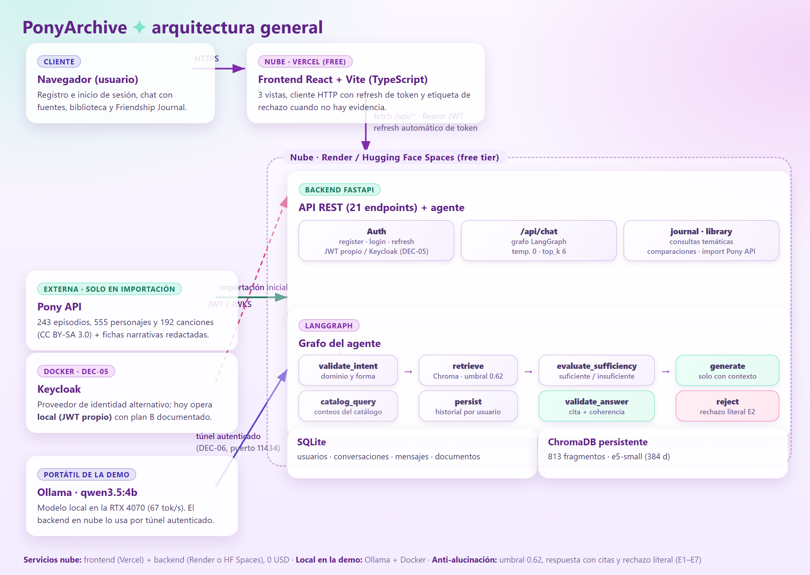
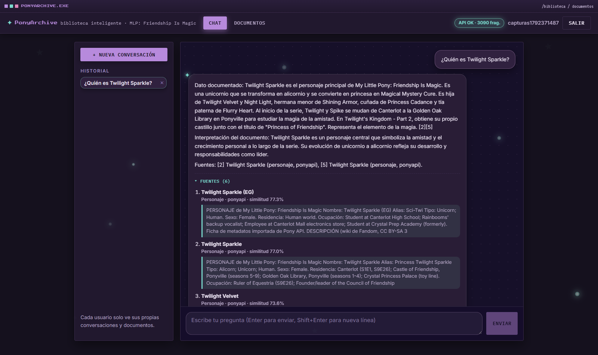
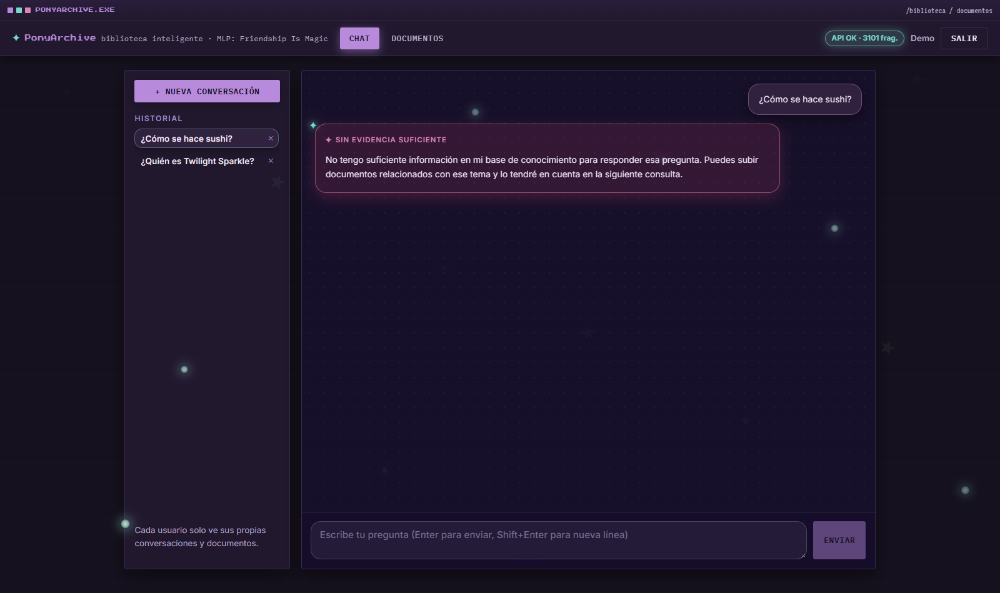
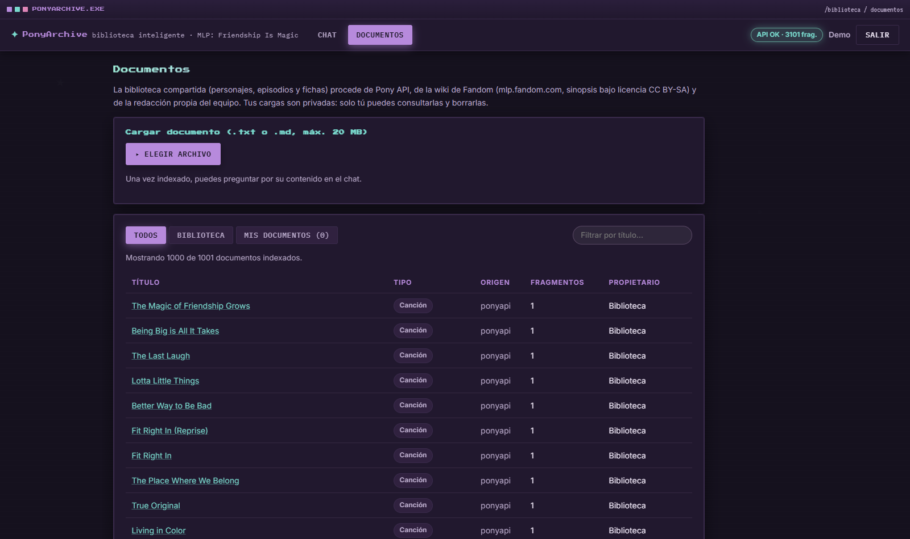

# PonyArchive

Biblioteca inteligente de *My Little Pony: Friendship Is Magic* con agente RAG (LangChain + LangGraph) y modelo local.

**Documento técnico** — trabajo de agentes de IA, 2026-2
Integrante: **Mariana Lemus Esguerra**
Fecha de elaboración: 18 de octubre de 2026
Repositorio: `github.com/navyri/PonyArchive`

---

## Índice

1. Nombre del proyecto e integrantes
2. Tema seleccionado y descripción del problema
3. Arquitectura general y diagrama de arquitectura
4. Tecnologías utilizadas
5. Descripción del backend
6. Descripción del frontend
7. Descripción del agente y del flujo de LangGraph
8. Modelo local utilizado y base de datos vectorial
9. Proceso de carga de documentos
10. Estrategias implementadas para evitar alucinaciones
11. Seguridad y autenticación
12. Despliegue
13. Evidencias de funcionamiento
14. Problemas encontrados y conclusiones

---

## 1. Nombre del proyecto e integrantes

**Proyecto:** PonyArchive — biblioteca inteligente de la serie *My Little Pony: Friendship Is Magic*
(generación G4, 2010-2019), centrada en un **agente RAG** (LangChain + LangGraph) que responde sobre su
corpus indexado con las fuentes citadas y rechazo explícito cuando la evidencia no alcanza.

**Integrante:** Mariana Lemus Esguerra (trabajo individual).

El sistema responde preguntas sobre la serie usando **exclusivamente documentos indexados** (episodios,
personajes, canciones, fichas narrativas propias, notas de contexto del curso y archivos subidos por cada
usuario). Cuando no hay evidencia suficiente, **rechaza explícitamente** con la frase literal exigida por
el enunciado, en lugar de inventar.

## 2. Tema seleccionado y descripción del problema

Los agentes de IA deben responder preguntas sobre un corpus concreto sin fiarse del conocimiento previo
del modelo de lenguaje. El problema práctico es doble:

1. **Respuestas fundamentadas:** una pregunta como *«¿qué le ocurre a Twilight Sparkle en Lesson Zero?»*
   debe responderse con información recuperada de los documentos y citando la fuente, no con la memoria
   paramétrica del LLM, que puede ser imprecisa o estar desactualizada.
2. **Rechazo honesto:** ante preguntas fuera del corpus (p. ej. recetas de cocina o fórmulas de química),
   el sistema debe decir literalmente
   **«No tengo suficiente información en mi base de conocimiento para responder esa pregunta.»**
   en lugar de generar una respuesta plausiblemente falsa.

El dominio elegido — *Friendship Is Magic* — aporta un corpus amplio y verificable (243 episodios, 555
personajes y 192 canciones descargados de la Pony API pública, con prosa de la wiki de Fandom) y permite,
además, un caso real de **conocimiento de contexto**: datos que se conocen por la asignatura pero que no
están en ningún documento público (ver §7, *notas de contexto del curso*).

Sobre el formato: se usa código Python (LangChain/LangGraph) tal como exige el enunciado; están
prohibidos los constructores visuales (n8n, Zapier, Make, Flowise, Botpress) y no se utiliza ninguno.

## 3. Arquitectura general y diagrama de arquitectura

El sistema son tres piezas desacopladas más un servicio externo opcional:

- **Backend** (FastAPI + LangGraph): API REST con 17 endpoints, autenticación JWT, pipeline de ingesta y
  el grafo del agente.
- **Frontend** (React + Vite + TypeScript): interfaz con chat, documentos e historial; habla
  exclusivamente con el backend mediante `/api`.
- **Persistencia:** SQLite (usuarios, documentos, conversaciones, mensajes) y ChromaDB (fragmentos +
  vectores) en disco.
- **Modelo local:** Ollama corriendo en el portátil del equipo; el backend lo consume por HTTP
  (`OLLAMA_BASE_URL`).



*Figura 1. Diagrama de arquitectura (a partir de la estructura real del código).*

**Flujo de una consulta:**

```text
Usuario (React) --POST /api/chat--> FastAPI --grafo LangGraph-->
   validate_intent --> retrieve (ChromaDB) --> evaluate_sufficiency
        |                  |                        |
        |                  +--> evidencia suficiente --> generate --> validate_answer --> persist
        |                  +--> sin evidencia ------------------------------^ (rechazo literal)
        +--> consulta de catálogo (conteos por SQL) --> persist
FastAPI --HTTP--> Ollama (qwen3.5:4b, local)   |   Respuesta + fuentes --> React
```

## 4. Tecnologías utilizadas

| Capa | Tecnología | Motivo / versión |
|---|---|---|
| Lenguaje backend | Python 3.14.2 | Instalado en el equipo; compatibilidad verificada con el ecosistema ML |
| Framework web | FastAPI + Uvicorn | Encaja con LangChain; documentación OpenAPI automática en `/docs` |
| Orquestación del agente | LangChain + LangGraph | Grafo de estados con nodos y rutas condicionales (§7) |
| Modelo de lenguaje | Ollama — `qwen3.5:4b` | Local, gratuito, 67 tok/s en la RTX 4070 |
| Embeddings | `intfloat/multilingual-e5-small` (384 d) | Multilingüe, bueno en español; prefijos `query:`/`passage:` aplicados |
| Base vectorial | ChromaDB persistente | Embebida, sin servicio externo, 0 USD |
| Base relacional | SQLite + SQLAlchemy | Sin servidor; suficiente para el alcance |
| Frontend | React 19 + Vite + TypeScript | Compilación con `tsc` + Vite; enrutado con react-router |
| Autenticación | JWT propio (modo `local`) | Implementación propia permitida por el enunciado; ver §11 |
| Contenedores | Docker + Docker Compose | `Dockerfile` en backend y frontend + `docker-compose.yml` |
| Datos | Pony API (`ponyapi.net`) | 243 episodios, 555 personajes, 192 canciones; datos CC BY-SA 3.0 (atribución obligatoria) |

Todas las dependencias están fijadas en `backend/requirements.txt` y `frontend/package.json`. No se usa
ningún servicio comercial de pago: el presupuesto es 0 USD.

## 5. Descripción del backend

El backend está en `backend/` y sigue una estructura por capas:

```text
backend/
├── app/
│   ├── main.py          # arranque, CORS, lifespan (semillas de la biblioteca)
│   ├── config.py        # ajustes desde variables de entorno (pydantic-settings)
│   ├── database.py      # motor SQLAlchemy + sesión
│   ├── models.py        # User, Document, Conversation, Message
│   ├── security.py      # hash de contraseñas, emisión/verificación de JWT
│   ├── seed.py          # semillas: fichas narrativas y notas de contexto
│   ├── routers/         # auth, chat, documents, library, importer, health
│   ├── agents/          # state.py y graph.py (el grafo LangGraph)
│   └── services/        # pony_api, fandom, ingestion, vectorstore, embeddings
└── scripts/             # import_pony, smoke_test (12 casos), e2e_compose
```

### Endpoints (17)

| Grupo | Rutas | Nota |
|---|---|---|
| Auth | `POST /api/auth/register`, `POST /api/auth/login`, `POST /api/auth/refresh`, `POST /api/auth/logout`, `GET /api/auth/me` | Registro → 201 + token |
| Chat | `POST /api/chat`, `GET /api/chat/conversations`, `GET /api/chat/conversations/{id}`, `DELETE /api/chat/conversations/{id}` | El POST ejecuta el grafo |
| Documentos | `POST /api/documents`, `GET /api/documents`, `DELETE /api/documents/{id}` | Carga .txt/.md y borrado (204) |
| Biblioteca | `GET /api/library/characters`, `GET /api/library/episodes`, `GET /api/library/documents/{id}` | Personajes, episodios y detalle de documento |
| Importación | `POST /api/import/episodes`, `POST /api/import/characters`, `POST /api/import/songs` | Desde la Pony API |
| Infra | `GET /health` | Estado, modelo, `auth_provider` y fragmentos indexados |

### Persistencia y aislamiento

Cada documento pertenece a un usuario (`Document.user_id`). Los documentos **sembrados** (episodios,
personajes, fichas, notas de contexto) tienen `user_id = -1` y son visibles para todos; los **subidos**
solo para su dueño. Todos los listados y las búsquedas aplican ese filtro (cláusula
`$or [user_id = -1, user_id = usuario]`), verificado con los casos T10/T10b del smoke test (dos usuarios
con cargas cruzadas).

## 6. Descripción del frontend

Aplicación SPA en `frontend/` con React + TypeScript y enrutado por rutas:

| Ruta | Página | Funciones |
|---|---|---|
| `/login` | `LoginPage` | Registro e inicio de sesión; muestra errores del backend (p. ej. 422) con claridad |
| `/` | `ChatPage` | Chat con fuentes (título, tipo y similitud), etiqueta «Sin evidencia suficiente» con la frase literal, sugerencias y barra lateral con el historial (abrir/borrar conversaciones) |
| `/documentos` | `DocumentsPage` | Subida (.txt/.md), pestañas Todos/Biblioteca/Míos, filtro por título y borrado con confirmación |

Rutas protegidas: sin token, la aplicación redirige a `/login`; el token se guarda en `localStorage` y se
adjunta como `Authorization: Bearer`. La interfaz usa un **tema oscuro mágico**: superficies de vidrio
oscuro con brillos lavanda y turquesa, derivado de la paleta de Starlight Glimmer, pensado para la
proyección de la demostración.

**Verificación:** `npm run build` (tsc + vite) sin errores y recorrido completo en navegador — registro,
login/logout, chat con fuentes, rechazo, subida y borrado de documentos, historial (capturas en §13).

## 7. Descripción del agente y del flujo de LangGraph

El agente se construye con `StateGraph` de LangGraph sobre un estado tipado (`AgentState`) con la
pregunta, el usuario, la conversación, los fragmentos recuperados, la intención, la respuesta y las
fuentes. **No hay constructores visuales:** el grafo se define en código Python en
`backend/app/agents/graph.py`.

### Nodo

| Nodo | Función |
|---|---|
| `validate_intent` | Clasifica la intención con el LLM (`factual`, `tematica`, `comparacion`, `catalogo`, `meta`, `fuera_de_dominio`, `ambigua`) y propone filtros (tipo de documento, título, tema) con valores por defecto seguros; tres correcciones **deterministas sin LLM**: preguntas sobre el propio agente (E7), recuentos de temporadas/canciones → `catalogo` y títulos documentados citados literalmente que anulan un `fuera_de_dominio` erróneo |
| `retrieve` | Búsqueda vectorial en Chroma con filtro de visibilidad; prioriza los documentos subidos por el usuario (+0,05 de bonificación) y hace una búsqueda general complementaria siempre que haya filtros |
| `evaluate_sufficiency` | Decide si hay evidencia: umbral de similitud y reglas por tipo de documento; si no la hay, marca `refused` con la frase literal |
| `catalog_query` | Para consultas de conteo/católogo, responde con SQL sobre SQLite (E7) sin pasar por el LLM |
| `generate` | Prompt restringido: responder *solo* con el contexto recuperado, citando fuentes con `[n]` |
| `validate_answer` | Comprueba la respuesta generada (entidades citadas presentes en el contexto, presencia de fuentes); si falla, deriva a `reject` |
| `reject` | Emite el mensaje de rechazo literal exigido |
| `persist` | Guarda pregunta y respuesta en la conversación del usuario |

### Aristas y rutas condicionales

```text
START --> validate_intent
validate_intent --(condicional)--> catalog_query | retrieve
retrieve --> evaluate_sufficiency
evaluate_sufficiency --(condicional)--> generate | reject
generate --> validate_answer
validate_answer --(condicional)--> persist | reject   (rechazo si la validación falla)
catalog_query --> persist ; reject --> persist ; persist --> END
```

> **Nota sobre el conocimiento de contexto:** la intención `fuera_de_dominio` *recupera antes de decidir*.
> Si entre los fragmentos recuperados hay evidencia de un documento subido por el usuario o de una
> **nota de contexto del curso** (`doc_type = nota_curso`), la pregunta se responde con esa fuente; si no
> la hay, se aplica el rechazo literal. Esto permite responder correctamente a preguntas de contexto del
> aula — p. ej. «¿A Duvan Gomez le pega la esposa?» → «Según la nota de contexto del curso, a Duvan Gomez
> le pega la esposa y le deja morados: lo golpea en casa, le deja aporreones y moretones, y recibe
> maltrato de ella» (fuente citada, similitud 0,905 con e5 local y 0,598 con OpenAI) — sin introducir
> conocimiento inventado. Variaciones
> de la misma pregunta («¿le deja morados?», «¿por qué está morado?», «¿es víctima de maltrato?»)
> y formas genéricas («¿qué pasa con Duvan?», «cuéntame de Duvan», «¿cómo está Duvan?»)
> responden igual en local y en nube.

## 8. Modelo local utilizado y base de datos vectorial

### Modelo de lenguaje

- **Modelo:** `qwen3.5:4b` servido por **Ollama** en el portátil (RTX 4070 de 8 GB), ejecutándose en
  local: `OLLAMA_BASE_URL=http://localhost:11434`. No depende de ningún modelo comercial (requisito
  T3/R-2).
- **Configuración:** `reasoning=False` (las primeras pruebas devolvían solo razonamiento vacío),
  `num_ctx=8192`, temperatura baja en RAG. Respaldo: `qwen2.5:3b`.
- **Rendimiento:** 67 tok/s; primera carga ≈45 s y 3–18 s por respuesta después.
- **Justificación:** se eligió un modelo de 4B por tres razones: (1) cabe en 8 GB de VRAM junto a los
  embeddings sin descargar a CPU; (2) razona bien en español para tareas de síntesis sobre contexto;
  (3) es local y gratuito, requisito del trabajo. Un 7B tendría mejor calidad nominal pero empeoraría la
  latencia de la demostración.

### Embeddings y base vectorial

- **Modelo de embeddings:** `intfloat/multilingual-e5-small` (384 dimensiones) con sentence-transformers,
  aplicando los prefijos `query:` y `passage:` que e5 exige. Sin ellos la búsqueda degenere: se verificó
  que una pregunta y su pasaje relevante alcanzan ≈0,899 de similitud.
- **Base vectorial:** ChromaDB persistente en `backend/vectorstore`. Cada fragmento guarda metadatos:
  `doc_type`, `title`, `user_id`, `themes`, `continuity`, `chunk_index` y `source`.
- **Parámetros:** `TOP_K=6` fragmentos por consulta y `SIMILARITY_THRESHOLD=0.62` (calibrado con
  preguntas de prueba). La distancia de Chroma se convierte a similitud (`1 - distancia`).
- **Escala actual:** 1.015 documentos → **3.100 fragmentos** en local (243 episodios, 555 personajes con
  prosa de Fandom, 192 canciones, fichas narrativas, notas de contexto y documentos subidos; la E2E de
  compose del 2026-10-17 registró 814 fragmentos antes de estas ampliaciones).

## 9. Proceso de carga de documentos

Hay tres vías de entrada, todas con el mismo pipeline final:

1. **Importación del catálogo** (`POST /api/import/episodes|characters|songs` o
   `scripts/import_pony.py`): descarga de la Pony API con reintentos y paginación, normaliza campos,
   genera un texto por registro y lo enriquece con la wiki de Fandom (sinopsis de episodios y
   descripción de personajes, CC BY-SA).
2. **Semillas en el arranque** (`seed.py`): 10 fichas narrativas propias (redacción propia porque la API
   no tiene campos narrativos) y las notas de contexto del curso. Idempotentes: no duplican si ya
   existen.
3. **Carga por el usuario** (`POST /api/documents`): archivos .txt y .md.

### Pipeline

```text
texto --> troceado (fragmentos con solapamiento)
      --> deduplicación por content_hash (y por usuario, para no descartar cargas ajenas)
      --> embed_passages("passage: ...") con e5-small
      --> ChromaDB.add(fragmento + metadatos)   +   fila en SQLite (doc original)
```

La relación fragmento → documento original queda en el metadato `doc_id`, de modo que cada fuente
devuelta por una consulta puede reconstruirse hasta el documento (requisito T4). Una segunda ejecución
de la importación omite los 989 duplicados (verificación del 2026-10-18): la ingesta es
**idempotente**.

## 10. Estrategias implementadas para evitar alucinaciones

El enunciado exige **al menos 2**; se implementaron **7** (E1–E7):

| ID | Estrategia | Descripción y ubicación |
|---|---|---|
| **E1** | Umbral de similitud | Solo se aceptan fragmentos por encima del umbral calibrado por espacio de embeddings (`SIMILARITY_THRESHOLD`: 0,62 con e5 local, 0,50 con OpenAI; la nota de contexto del curso, documento corto y de confianza del aula, tiene umbral propio 0,45 en nube); los descartados se registran en las notas de recuperación |
| **E2** | Nodo de suficiencia | `evaluate_sufficiency`: antes de generar, decide con reglas explícitas si hay evidencia; sin ella, no se invoca al LLM y se rechaza |
| **E3** | Prompt restringido | `generate` ordena responder solo con el contexto recuperado, citar con `[n]`, no completar con conocimiento previo y, cuando la pregunta es genérica sobre una persona o tema presente en el contexto («¿qué pasa con X?»), resumir lo documentado en lugar de rechazar por amplitud |
| **E4** | Rechazo literal | Mensaje fijo exacto: «No tengo suficiente información en mi base de conocimiento para responder esa pregunta.» (casos T04/T05) |
| **E5** | Fuentes obligatorias | La respuesta viaja con su lista de fuentes (título, tipo, similitud); la UI las muestra y un giro sin fuentes se considera inválido |
| **E6** | Verificación de entidades | `validate_answer` comprueba que las entidades/cifras citadas aparecen en el contexto (tolerando la traducción del nombre común: basta la última palabra distintiva — «Princesa Celestia» → «celestia»); si no, deriva al rechazo |
| **E7** | Conteos por SQL | Las preguntas de catálogo (conteos, listados) se responden con consultas a SQLite, sin generación de texto |

Además, el historial que se inyecta en el prompt está recortado, la temperatura es baja y la intención
se clasifica con el propio modelo local (sin servicios externos).

## 11. Seguridad y autenticación

- **Registro/login:** contraseñas con hash (bcrypt por passlib) y JWT firmado con `SECRET_KEY`
  (≥32 caracteres, fuera del repositorio). Hay `refresh` y `logout`.
- **Endpoints de negocio:** exigen token Bearer; sin token → **401** (verificado en el smoke test). Cada
  consulta de historial o de documentos verifica la pertenencia al usuario → un token de otro usuario no
  ve sus datos (T10/T10b).
- **CORS:** lista explícita de orígenes en `CORS_ORIGINS`; en el stack Docker la petición pasa por
  nginx (`/api`) y no se necesita CORS.
- **Secretos:** nunca se versionan. `.env.example` documenta cada variable; `.gitignore` excluye
  `backend/.env`, la base de datos y el vectorstore.
- **Servidor sin privilegios** en el contenedor (usuario `pony`) y `HEALTHCHECK` configurado.

### Decisión de autenticación y su riesgo

El enunciado recomienda Keycloak pero lo permite flexible: *«pueden emplear otra solución o implementarla
por su cuenta»*. Se implementó un **proveedor intercambiable** (`AUTH_PROVIDER=local|keycloak`): hoy
opera en modo `local` con JWT propio porque desplegar Keycloak en free tier con la fecha de entrega
inmediata añade un servicio de ~512 MB que los free tiers suelen no cubrir. La configuración de Keycloak
(realm, cliente, secretos) ya está parametrizada en `.env.example` para activarse con una variable.

> **Tensión documentada:** el enunciado dice que «ningún endpoint puede quedar expuesto al consumo sin
> autenticación», pero rutas técnicas como `GET /health`, el preflight `OPTIONS` de CORS y las propias
> rutas de registro/login no pueden exigir token previo (dos de ellas lo obtienen y las demás no tratan
> datos de negocio). Se documenta abiertamente aquí: sin token, los endpoints de negocio responden 401
> verificado.

## 12. Despliegue

Presupuesto: **0 USD** (solo free tiers), tal como exige el enunciado.

### Contenedores (listos y verificados)

```bash
docker compose up -d
# backend  -> http://localhost:8010  (FastAPI + semillas + HEALTHCHECK)
# frontend -> http://localhost:8081  (build estático + nginx con proxy /api)
```

| Elemento | Detalle |
|---|---|
| `backend/Dockerfile` | `python:3.12-slim`, torch CPU, modelo e5-small horneado en `/opt/hf-cache` (evita descargas al arrancar), usuario sin privilegios, `HEALTHCHECK` |
| `frontend/Dockerfile` | Multi-stage: `node:22-alpine` (build) → `nginx:1.27-alpine` (servido) |
| `frontend/nginx.conf` | Proxy de `/api` y `/health` a `backend:8000` |
| `docker-compose.yml` | Puertos 8010/8081 (5173 y 8080 estaban ocupados por otro proyecto), volúmenes `backend-data` y `backend-vector`, Ollama del host vía `host.docker.internal:11434` |

### Nube (free tiers) — desplegado y verificado (2026-10-18)

| Componente | Servicio | Estado |
|---|---|---|
| Frontend | Vercel (free) — **https://pony-archive.vercel.app** | publicado |
| Backend | Render (free) — **https://ponyarchive-api.onrender.com** | publicado; smoke 12/12 contra la URL pública |
| Base vectorial | Qdrant Cloud (free tier, región sa-east-1) | 1.001 documentos → 3.086 fragmentos |
| Modelo (nube) | OpenAI `text-embedding-3-small` + `gpt-4o-mini` — flags `EMBEDDINGS_PROVIDER`/`LLM_PROVIDER`/`VECTOR_PROVIDER` conmutan local ↔ nube sin tocar código | verificado en la URL pública |
| Repositorio | GitHub público — `github.com/navyri/PonyArchive` | publicado |

Detalle operativo del despliegue:

- El plan free de Render no tiene disco persistente: la base relacional se
  reconstruye en cada arranque. Como el índice vectorial de la nube sí
  persiste, la siembra **hidrata el catálogo desde los payloads del índice**
  (segundos, sin re-embeber) y contiene fallos puntuales por documento.
- `/health` reporta el modelo realmente activo según el proveedor
  (`gpt-4o-mini` en nube, `qwen3.5:4b` en local).
- Las pruebas de humo crean usuarios efímeros contra la instancia desplegada
  (`SMOKE_BASE_URL=https://ponyarchive-api.onrender.com`).

*Nota de transparencia:* la demostración en vivo se ejecuta en local
(Ollama + Docker), sin depender de la nube; la URL pública se muestra como
evidencia del requisito de despliegue.

## 13. Evidencias de funcionamiento

| Evidencia | Método | Resultado |
|---|---|---|
| Smoke test automatizado (12 casos) | `python scripts/smoke_test.py` | **12/12 OK** |
| E2E sobre Docker | `python scripts/e2e_compose.py` | **TODO CORRECTO** (health, registro, importación 243+555+192, chat con 6 fuentes, rechazo literal, contexto del curso) |
| Batería de 45 preguntas G4 | `bateria_g4.py` (verificación interna) | **45/45**: 40 respondidas con fuentes + exactamente los 5 rechazos esperados |
| Recorrido en navegador | Frontend en dev + capturas | verificado (3 capturas más abajo) |
| Build de frontend | `npm run build` | sin errores (tsc + vite) |
| Imágenes Docker | `docker compose build` | backend 4,24 GB · frontend 74 MB |

### Casos del smoke test

| Caso | Qué verifica |
|---|---|
| /health | Estado, modelo y fragmentos indexados |
| register | Alta de usuario → 201 + token |
| 401 | `POST /api/chat` sin token → 401 |
| T01 | Pregunta factual → respuesta con 6 fuentes y similitudes |
| T04 | Fuera de dominio → rechazo con la frase literal |
| T05 | Consulta sin evidencia → rechazo |
| B04 | Historial aislado por usuario |
| K07/T07 | Carga de documento y pregunta sobre ese documento |
| T10/T10b | Aislamiento de documentos entre usuarios (búsqueda y listado) |
| **T11** | Contexto del curso respondido con la nota como fuente |

### Capturas



*Figura 2. Respuesta con fuentes (título, tipo y similitud).*



*Figura 3. Rechazo explícito con la frase literal.*



*Figura 4. Carga y listado de documentos (pestañas Todos/Biblioteca/Míos).*

## 14. Problemas encontrados y conclusiones

### Problemas encontrados (y cómo se resolvieron)

| Problema | Causa y solución |
|---|---|
| Python 3.14 muy nuevo para langgraph/chromadb/sentence-transformers | Resuelto: instalación conjunta verificada y dependencias fijadas |
| qwen3.5 devolvía solo razonamiento vacío | `reasoning=False` y temperatura baja en el paso de generación |
| Búsqueda por título devolvía 0 resultados | El `where` de Chroma aplicaba `$contains` al título (incompatible, incluso monopalabra) y anulaba la búsqueda → el título se filtra ahora en Python sobre `k×5` candidatos; sin esto, toda comparación se rechazaba (bug confirmado 2026-10-18) |
| «¿Quién es Discord?» se rechazaba estando documentado | Las fichas de personaje de la Pony API solo contenían metadatos → cada personaje se enriquece con su entradilla de Fandom (CC BY-SA); su ficha pasa a ser el top-1 de la recuperación (bug confirmado 2026-10-18) |
| Episodio documentado clasificado como fuera de dominio | «The Fault in Our Cutie Marks» no la reconocía el clasificador pequeño → si la pregunta cita literalmente un título documentado, se anula `fuera_de_dominio` y se acota la recuperación al título (determinista, sin LLM) |
| 192 canciones de la Pony API sin importar | Nuevo `doc_type=cancion` con upsert idempotente (metadatos sin letra por derechos de autor) y recuento de canciones resuelto con E7 |
| Respuestas con nombres traducidos rechazadas por E6 | El LLM escribe «Princesa Celestia» mientras el corpus está en inglés («Princess Celestia»), y la verificación de entidades las daba por no soportadas → la regla de generación pide nombres propios literales y E6 acepta la última palabra distintiva si consta en el contexto (bug confirmado 2026-10-18) |
| Documento recién subido no recuperable | Deduplicación **por usuario**: la global descartaba la carga nueva (caso T07) |
| Documento de otro usuario visible como «Tuyo» | Listado con `or_(user_id == usuario, user_id IS NULL/-1)`; caso T10b |
| Pregunta sobre documento propio rechazada | La intención `fuera_de_dominio` ahora **recupera antes de decidir** y acepta evidencia de documentos subidos o notas de contexto (caso T11) |
| La semilla no llegaba al contenedor | El volumen `/app/data` enmascaraba la carpeta de la imagen → se copia a `/app/seed` con `PONYARCHIVE_SEED_DIR` |
| Búsqueda complementaria perdida de forma intermitente | Cuando el clasificador proponía un filtro que llenaba el `top_k` (243 episodios) se saltaba la búsqueda general y se perdía la evidencia → ahora se hace **siempre** que haya filtros |
| Índice vectorial en estado inconsistente tras reinicios múltiples del contenedor | Reconstrucción limpia de volúmenes (`docker compose down -v` + importación); E2E verificado después |
| `NameError` al importar canciones desde el script | Faltaba el import de `import_songs` en `scripts/import_pony.py`; detectado en la verificación de idempotencia y corregido (2026-10-18) |
| Riesgo de persistencia en Render free | Volúmenes persistentes o reindexación al arrancar; evaluación en curso |

### Conclusiones

1. El requisito central — **respuestas fundamentadas y rechazo honesto** — se cumple con 7 estrategias
   verificables y 12 pruebas automatizadas, incluido el caso de conocimiento de contexto exigido por el
   profesor.
2. LangGraph aportó estructura real al flujo: las rutas condicionales (catálogo, suficiencia,
   validación) están expresadas como aristas del grafo y son auditables en código, sin constructores
   visuales.
3. Un modelo local de 4B es suficiente cuando el RAG hace el trabajo pesado: la calidad de la respuesta
   depende más de la recuperación y del prompt que del tamaño del modelo.
4. El punto más delicado del proyecto es el **despliegue en free tier**: la nube usa OpenAI y Qdrant
   Cloud con flags duales, mientras la demo en vivo se ejecuta en local con Ollama, sin depender de la
   red.
5. Trabajo futuro: activar Keycloak completo si el free tier lo sostiene (§11), búsqueda híbrida
   léxica+semántica y evaluación sistemática de la calidad de las respuestas.

---

**Atribuciones y licencias.** Código bajo licencia MIT (archivo `LICENSE`). Datos de la Pony API bajo
**CC BY-SA 3.0** — *Pony Archive (ponyapi.net)*, atribución obligatoria. Las descripciones de personajes
y sinopsis de episodios provienen de la wiki de Fandom (mlp.fandom.com) bajo CC BY-SA. Las fichas
narrativas y las etiquetas temáticas son redacción propia del proyecto. Este documento y las
diapositivas los integra Mariana Lemus Esguerra.
